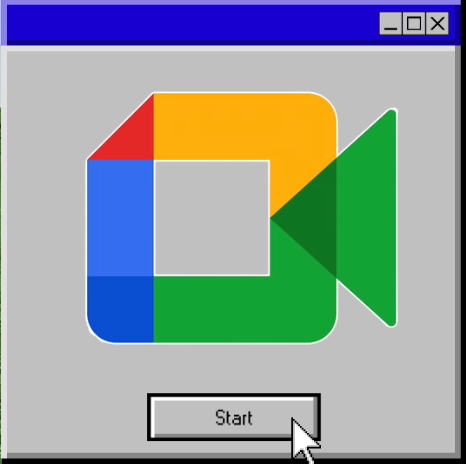
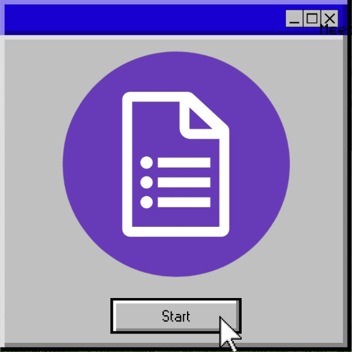
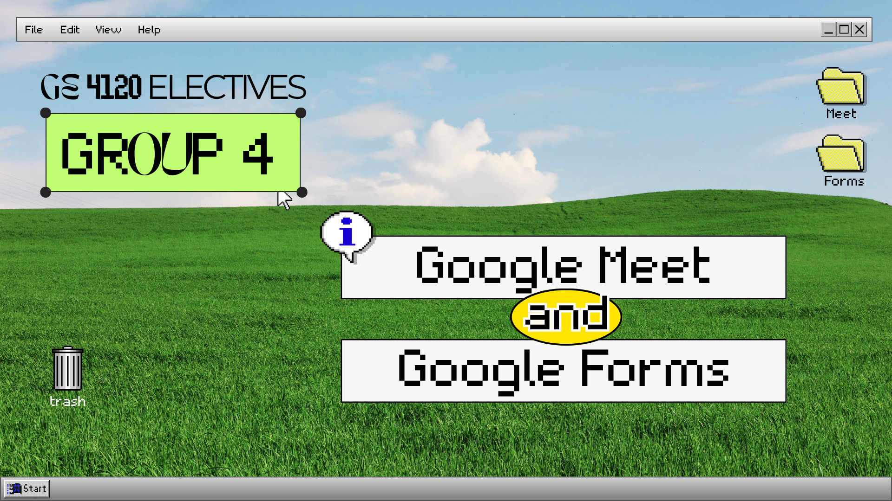

# 🍵 Activity 4 🌿

**✧⁺ MIDTERM REPORTING ⁺✧**
 
**GOOGLE MEET AND GOOGLE FORMS**

 

## Overview

 
This activity explores the purpose, features, and practical applications of **Google Meet** and **Google Forms** as essential digital tools for communication, collaboration, and information management.

|  | **Google Meet** is an online video conferencing platform that enables users to conduct virtual meetings, online classes, presentations, and group discussions through features such as screen sharing, in-meeting chat, captions, and collaborative controls. |
| :---: | :--- |
|  | **Google Forms** **allows users to create surveys, quizzes, registration forms, and feedback forms, collect responses in real time, and organize data through automatic summaries and Google Sheets integration.** |

*Through this activity, we learned how to navigate both platforms, understand their essential functions, and apply their features through practical demonstrations and interactive quizzes. These tools demonstrate how technology can make communication more accessible, simplify information gathering, support learning assessment, and improve productivity in academic and professional settings.*

 

<a href="https://github.com/lbfdelfierro/21st-CENTURY-IT-SKILLS/blob/21st-CENTURY-IT-SKILLS/GROUP-4-FORMS-AND-MEET-PPT.pdf">
  📄 View Google Meet & Forms PPT →
</a>

 
 

<a href="https://docs.google.com/forms/d/e/1FAIpQLSfperDHgiW2recV86enfxMl6Lav0aZCxHtS3fycjsJGuVEPvw/viewform?usp=sharing&ouid=118413879498339873868">
  📝 View Google Forms Quiz →
</a>

 
 

<a href="https://github.com/lbfdelfierro/21st-CENTURY-IT-SKILLS/blob/21st-CENTURY-IT-SKILLS/GE-4120-_-G4_Quiz.pdf">
  📊 View Classmates' Quiz Scores →
</a>

 
 
    
  

 

## Reflection

*Honestly, diving deeper into Google Meet and Google Forms for this activity made me realize how much we actually rely on these tools to survive college. As a student balancing crazy schedules, major exams, and endless group works, trying to get everyone in the same physical room is almost impossible. Google Meet has become a total lifesaver for those late-night group syncs, committee meetings, and exam cram sessions.*

*On the flip side, exploring the more advanced features of Google Forms completely changed how I approach data gathering. Instead of stressing over manual tallies for our research papers, surveys, or event registrations, Forms just automates all the heavy lifting for us.* 

*Ultimately, this activity shifted my perspective. These aren't just basic apps we use for class—they are essential organizational tools that keep the chaos of my academic life manageable, and I know they'll be just as crucial in my future professional practice.*

 

🍵 ──────────────────────────────────────── 🍵

