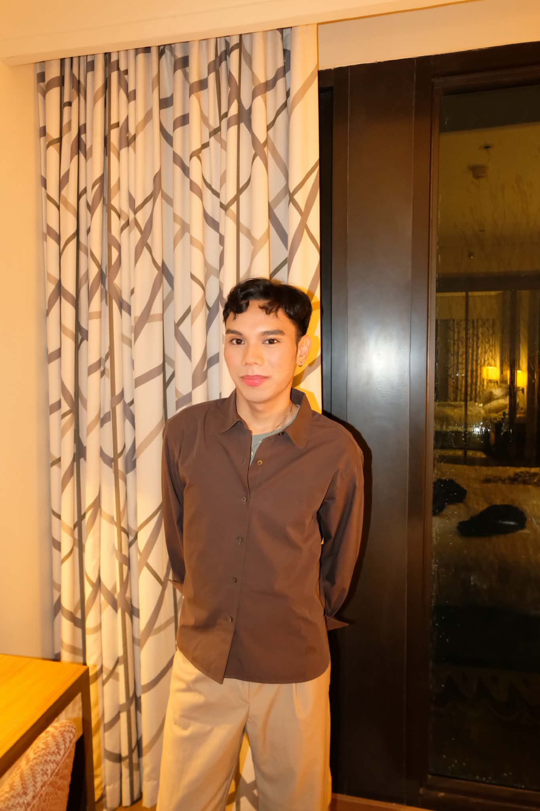

<table>
<tr>
<td width="190" align="center" valign="middle">

</td>
<td valign="middle">

# Louie Benedict F. Del Fierro

**GE 4120 – 21st Century IT Skills**

Bachelor of Science in Nursing  
Ateneo de Davao University

*Design • Creativity • Digital Productivity • Lifelong Learning*

</td>
</tr>
</table>

---

## 👋 About Me

Hello! I'm **Louie Benedict F. Del Fierro**, a Bachelor of Science in Nursing student at Ateneo de Davao University.

I enjoy exploring creative projects, digital tools, visual design, and different ways technology can make learning and everyday tasks more organized. Outside academics, I enjoy baking, especially making cinnamon rolls, and combining creativity with practical ideas.

This repository serves as my digital learning portfolio for **GE 4120 – 21st Century IT Skills**. It showcases my activities, outputs, and learning experiences throughout the course.

## 💻 Skills and Tools Explored

- Visual Communication and Presentation Design
- Color Palettes, Typography, and Branding
- Infographic Design and Digital Advocacy
- Google Meet and Google Forms
- Google Workspace
- Artificial Intelligence Tools and Prompt Improvement
- Website Planning and Creation
- Resume Development and Document Design

---

## 📚 Activities and Learning Outputs

Each activity has its own README file containing the activity description, outputs, learning experiences, challenges, and future applications.

| Activity | Topic | Activity Documentation | Actual Output |
|---|---|---|---|
| **Activity 1** | Presentation Design Principles | [Read Activity 1](Activity-01/Activity-01/README.md) | [Coffee For All Poster](https://github.com/lbfdelfierro/21st-CENTURY-IT-SKILLS/blob/21st-CENTURY-IT-SKILLS/ACTIVITY%20%231%20-%20GE%204120%20-%20DEL%20FIERRO.png) |
| **Activity 2** | Color Palette and Typography | [Read Activity 2](Activity-01/Activity-01/Activity-02/README.md) | [Main Logo](Activity-02/images/louies-cinnamon-rolls-logo.jpg) · [Logo Variation](Activity-02/images/brand-logo-variation.jpg) · [Color Palette and Typography](Activity-02/images/color-palette-typography.jpg) · [Business Card](Activity-02/images/business-card.jpg) |
| **Activity 3** | Social Media Infographics and Documentation | [Read Activity 3](Activity-01/Activity-01/Activity-02/Activity-03/README.md) | [SafeLine PH Infographic](https://github.com/lbfdelfierro/21st-CENTURY-IT-SKILLS/blob/21st-CENTURY-IT-SKILLS/ACTIVITY%20%233%20-%20Infographic_DELFIERRO.jpg) |
| **Activity 4** | Google Meet and Google Forms | [Read Activity 4](Activity-01/Activity-01/Activity-02/Activity-03/Activity-04/README.md) | [Group Presentation](https://github.com/lbfdelfierro/21st-CENTURY-IT-SKILLS/blob/21st-CENTURY-IT-SKILLS/ACTIVITY%20%234.md) · [Quiz Scores](Activity-04/documents/google-forms-quiz-scores.pdf) |
| **Activity 5** | AI Tools – Prompt Improvement | [Read Activity 5](Activity-01/Activity-01/Activity-02/Activity-03/Activity-04/Activity-05/README.md) | [Activity 5 Report](https://github.com/lbfdelfierro/21st-CENTURY-IT-SKILLS/blob/21st-CENTURY-IT-SKILLS/Activity%205_Del%20Fierro.pdf) |
| **Activity 6** | Making a Website | [Read Activity 6](Activity-01/Activity-01/Activity-02/Activity-03/Activity-04/Activity-05/Activity-06/README.md) | [Activity 6 Documentation](DELFIERRO_ACTIVITY6.pdf) · [Visit Website](https://canva.link/9tmmo61hp6o4opx) |
| **Activity 7** | Resume Generation | [Read Activity 7](Activity-01/Activity-01/Activity-02/Activity-03/Activity-04/Activity-05/Activity-06/Activity-07/README.md) | [Activity 7 Documentation](DELFIERRO_ACTIVITY7.pdf) |

---

## 📎 Examinations and Other Course Materials

| Resource | Description | Link |
|---|---|---|
| **Midterm / Laboratory Examination** | Shared folder containing the examination and laboratory materials | [Open Google Drive Folder](https://drive.google.com/drive/u/1/folders/1IXIlKtJt6_dnVHg5CTUSmA2YlJ8jNbfe) |
| **Group 4 Presentation** | Google Meet and Google Forms presentation | [View Presentation PDF](Activity-04/documents/google-meet-and-google-forms-presentation.pdf) |
| **Google Forms Quiz** | Online quiz used in the group activity | [Open Google Forms](https://docs.google.com/forms/d/e/1FAIpQLSfperDHgiW2recV86enfxMl6Lav0aZCxHtS3fycjsJGuVEPvw/viewform?usp=sharing&ouid=118413879498339873868) |
| **Google Forms Quiz Scores** | Consolidated quiz results, included with permission | [View Scores PDF](Activity-04/documents/google-forms-quiz-scores.pdf) |
| **Louie's Cinnamon Rolls Website** | Website developed for Activity 6 | [Visit Website](https://canva.link/9tmmo61hp6o4opx) |

---

## 🌱 My Learning Reflection

Throughout GE 4120 – 21st Century IT Skills, I gained a better understanding of how technology can support creativity, communication, collaboration, and productivity.

Each activity provided an opportunity to explore different digital tools and apply them to practical situations. From designing promotional materials and creating infographics to exploring artificial intelligence and developing a website, I discovered how technology can turn ideas into meaningful outputs.

I also learned that digital literacy is not simply about knowing how to use applications. It involves using technology effectively, responsibly, and creatively while continuously adapting to new tools and developments.

As a nursing student, I believe these skills will be valuable in my academic journey and future professional practice, particularly in communication, information management, health education, and lifelong learning.

This portfolio represents not only the outputs I completed but also the knowledge and skills I developed throughout the course.

---

**Thank you for visiting my digital portfolio!** 🌿

*Ateneo de Davao University*  
*GE 4120 – 21st Century IT Skills*

